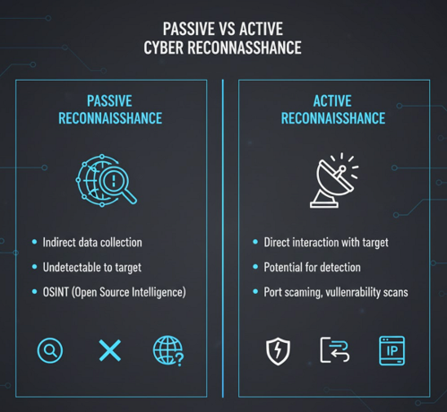
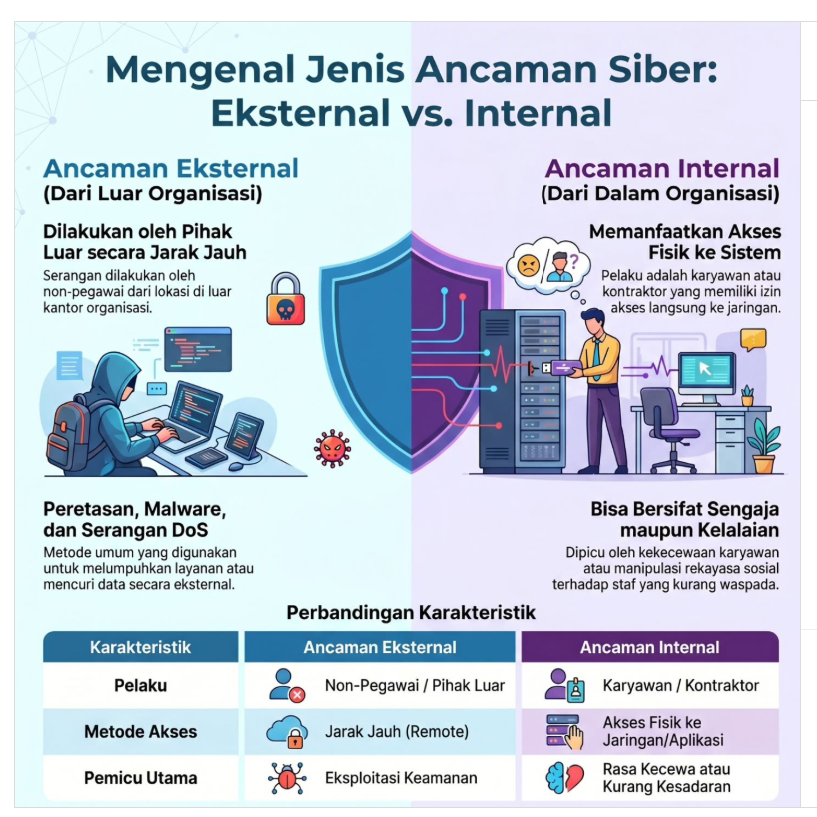
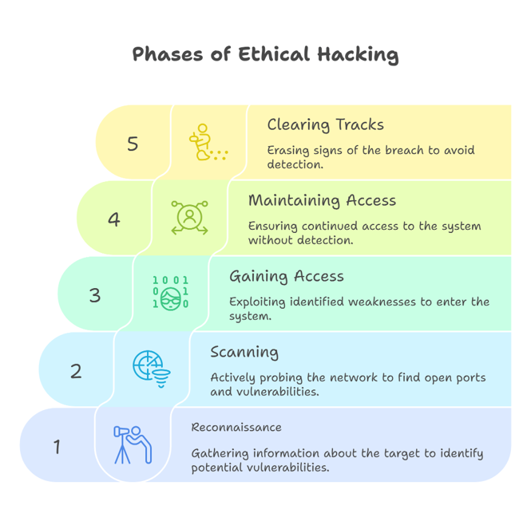
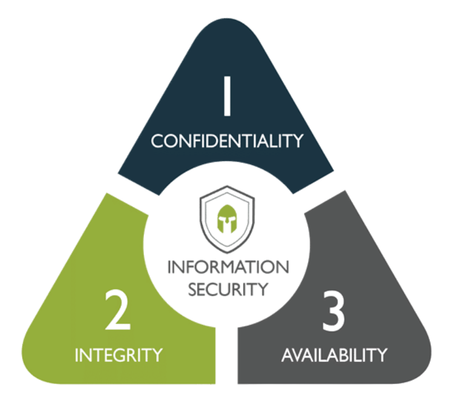
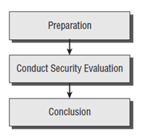

# 🛡️ Pengenalan Ethical Hacking

Kebanyakan orang berpikir bahwa "hacker" adalah seseorang dengan *skill* luar biasa yang mengetikkan perintah di layar komputer dengan cepat untuk mencuri nomor rekening atau data rahasia. Pada kenyataannya, peretas (*hacker*) yang baik adalah mereka yang sangat memahami cara kerja sebuah sistem komputer dan mengetahui *tools* yang tepat untuk mencari celah keamanan guna melindunginya.

Repositori ini merangkum konsep dasar, terminologi, tahapan, hingga jenis-jenis pengujian dalam dunia *Ethical Hacking*.

---

## 📌 Daftar Isi

1. [Terminologi Penting](#-terminologi-penting)
2. [Berbagai Jenis Teknologi & Serangan](#-berbagai-jenis-teknologi--serangan-hacking)
3. [5 Tahapan Ethical Hacking](#-5-tahapan-ethical-hacking)
4. [Hacktivism & Tipe-Tipe Hacker](#-hacktivism--tipe-tipe-hacker)
5. [Tujuan Keamanan & Segitiga Fungsionalitas](#-tujuan-keamanan--segitiga-fungsionalitas)
6. [Keterampilan & Vulnerability Research](#-keterampilan-yang-dibutuhkan--vulnerability-research)
7. [Kerangka Kerja & Evaluasi Keamanan](#-kerangka-kerja--evaluasi-keamanan)
8. [Tipe-Tipe Ethical Hacking & Pengujian](#-tipe-tipe-ethical-hacking--pengujian)
9. [Laporan Ethical Hacking](#-laporan-ethical-hacking)

---

## 📖 Terminologi Penting

Dalam *ethical hacking*, terdapat beberapa istilah dasar yang wajib dipahami:

*   **Threat (Ancaman):** Lingkungan atau situasi yang dapat mengakibatkan potensi penerobosan keamanan.
*   **Exploit:** Perangkat lunak yang memanfaatkan *bug*, kesalahan, atau kerentanan, yang menyebabkan akses tidak sah, eskalasi hak istimewa, atau *denial of service* (DoS).
    *   *Remote exploit:* Bekerja melalui jaringan tanpa akses sebelumnya ke sistem.
    *   *Local exploit:* Membutuhkan akses sebelumnya ke sistem untuk meningkatkan hak istimewa (*privilege escalation*).
*   **Vulnerability (Kerentanan):** Cacat perangkat lunak, desain logika, atau kesalahan konfigurasi yang dapat dieksploitasi.
*   **Target of Evaluation (TOE):** Sistem, program, atau jaringan yang menjadi subjek analisis keamanan atau serangan.

---

## ⚔️ Berbagai Jenis Teknologi & Serangan Hacking

Banyak alat digunakan untuk mengeksploitasi sistem (seperti *Trojans, backdoor, sniffer, rootkit, SQL Injection*). Sebagian besar *tools* ini mengeksploitasi kelemahan di 4 area utama:

1.  **Operating System:** Pengaturan *default* instalasi yang seringkali meninggalkan kerentanan.
2.  **Application:** Kurangnya pengujian kerentanan saat pengembangan (cacat pemrograman).
3.  **Shrink-wrap code:** Fitur tambahan bawaan dari program komersial (misal: makro MS Word) yang bisa disalahgunakan.
4.  **Misconfigurations:** Kesalahan konfigurasi keamanan atau membiarkannya di tingkat terendah demi kemudahan pengguna.

# Klasifikasi Serangan Keamanan Siber (Cybersecurity Attacks)

Dokumen ini menjelaskan pengategorian serangan siber berdasarkan tindakan yang dilakukan pelaku dan asal muasal serangan terhadap perimeter keamanan organisasi.

---

## 1. Berdasarkan Tindakan: Serangan Aktif vs. Pasif
Kategori ini melihat apakah serangan tersebut mengubah sistem atau hanya mengintip data.

### 🕵️‍♂️ Serangan Pasif (*Passive Attack*)
Pelaku hanya mengintai, memonitor, atau menyadap data tanpa mengubahnya dengan tujuan utama untuk mendapatkan informasi. Karena sistem tetap berjalan normal, serangan jenis ini sangat sulit dideteksi.
* **Tujuan utama:** Memperoleh informasi rahasia.
* **Dampak sistem:** Tidak ada perubahan pada sistem (berjalan normal).
* **Contoh:** 
  * Menyadap Wi-Fi publik (*Eavesdropping*).
  * Menganalisis lalu lintas jaringan (*Traffic Analysis*).

### ⚡ Serangan Aktif (*Active Attack*)
Pelaku secara sengaja mengubah, merusak, menghapus, atau memanipulasi data dan sistem. Serangan ini berdampak langsung pada ketersediaan (*availability*) atau integritas (*integrity*) sistem.
* **Tujuan utama:** Merusak atau memanipulasi data/sistem.
* **Dampak sistem:** Mengganggu ketersediaan atau integritas data secara langsung.
* **Contoh:**
  * Mengubah isi pesan (*Man-in-the-Middle*).
  * Menyamar sebagai orang lain (*Spoofing*).
  * Membuat sistem lumpuh/down (*DoS/DDoS*).

---

## 2. Berdasarkan Asal Pelaku: Serangan *Inside* vs. *Outside*
Kategori ini melihat posisi pelaku terhadap batasan keamanan (*security perimeter*) organisasi.

### 🏢 Serangan Inside (*Insider Attack*)
Serangan yang berasal dari orang dalam yang memiliki akses resmi ke jaringan atau sistem, namun menyalahgunakan hak akses tersebut.
* **Pelaku:** Karyawan, mantan karyawan, atau kontraktor.
* **Karakteristik:** Sudah memiliki hak akses resmi di dalam perimeter keamanan.
* **Contoh:** Karyawan yang mencuri data rahasia perusahaan untuk dijual ke kompetitor.

### 🌐 Serangan Outside (*Outsider Attack*)
Serangan yang berasal dari luar organisasi oleh pihak asing yang tidak memiliki hak akses resmi. Pelaku harus menembus dinding pertahanan untuk bisa masuk.
* **Pelaku:** Pihak luar, peretas asing, atau entitas luar lainnya.
* **Karakteristik:** Harus menembus dinding pertahanan (seperti *firewall*) terlebih dahulu.
* **Contoh:** Hacker dari negara lain yang mencoba meretas situs web perusahaan atau mengirimkan malware.

---

## 🔄 5 Tahapan Ethical Hacking

Proses peretasan yang terstruktur biasanya mengikuti 5 fase utama ini:

1.  **Tahap 1: Pengintaian (Reconnaissance)**
    *   *Pasif:* Mengumpulkan informasi tanpa menyentuh target secara langsung (tanpa sepengetahuan target).
    *   *Aktif:* Menyelidik jaringan secara langsung untuk menemukan *host*, IP, dan layanan.
2.  **Tahap 2: Scanning**
    *   Memeriksa jaringan menggunakan informasi dari tahap pengintaian (menggunakan *port scanner, vulnerability scanner*, dll) untuk mencari celah masuk.
3.  **Tahap 3: Mendapatkan Akses (Gaining Access)**
    *   Fase peretasan sebenarnya. Kerentanan yang ditemukan kini dieksploitasi untuk mendapatkan kendali atas sistem.
4.  **Tahap 4: Mempertahankan Akses (Maintaining Access)**
    *   Menanamkan *backdoor, rootkit*, atau *Trojan* untuk memastikan peretas tetap bisa masuk ke sistem di masa depan tanpa harus mengulang eksploitasi dari awal.
5.  **Tahap 5: Menutupi Jejak (Covering Tracks)**
    *   Menghapus *log*, menyembunyikan *file*, dan menghilangkan bukti peretasan untuk menghindari deteksi penegak hukum atau administrator keamanan.

---

## 🎭 Hacktivism & Tipe-Tipe Hacker

**Hacktivism** adalah peretasan untuk suatu tujuan/sebab, biasanya didorong oleh agenda sosial atau politik demi menyampaikan pesan tertentu.

Secara umum, *hacker* dibagi menjadi 3 kategori:
*   ⚪ **White Hats:** Peretas baik (*ethical hacker*) yang meretas untuk tujuan defensif.
*   ⚫ **Black Hats (Crackers):** Peretas jahat yang meretas untuk tujuan ilegal atau destruktif.
*   🔘 **Grey Hats:** Berada di wilayah abu-abu; kadang bekerja secara defensif, kadang ofensif tergantung situasi dan motif.

> **Apa yang dilakukan Ethical Hacker?** Mereka menggunakan alat dan metode yang sama dengan *crackers*, namun dengan izin resmi untuk menemukan celah sebelum dimanfaatkan oleh pihak jahat (dikenal sebagai *Penetration Testing*).

---

## 🎯 Tujuan Keamanan & Segitiga Fungsionalitas

Seorang *hacker* berusaha menghancurkan satu atau lebih dari 4 elemen dasar keamanan ini:
1.  **Confidentiality** (Kerahasiaan)
2.  **Authenticity** (Keaslian)
3.  **Integrity** (Integritas)
4.  **Availability** (Ketersediaan)

### Segitiga Keamanan, Fungsionalitas, dan Kemudahan Penggunaan

Sebagai profesional keamanan, tantangan terbesarnya adalah menyeimbangkan segitiga ini. Semakin tinggi **Keamanan** (Security) yang diterapkan, biasanya **Fungsionalitas** (Functionality) dan **Kemudahan Penggunaan** (Ease of Use) bagi pengguna biasa akan semakin menurun.

---

## 🧠 Keterampilan yang Dibutuhkan & Vulnerability Research

*   **Keterampilan:** Pemrograman komputer tingkat lanjut, penguasaan jaringan, pemahaman mendalam tentang sistem operasi (Windows, Unix, Linux), serta kesabaran dan ketekunan yang luar biasa.
*   **Vulnerability Research:** Proses terus-menerus mencari dan mempelajari kerentanan/kelemahan desain terbaru. Seorang *ethical hacker* harus selalu *up-to-date* terhadap virus, *Trojan*, dan *exploit* terbaru untuk melindungi sistem secara memadai.

---

## 📋 Kerangka Kerja & Evaluasi Keamanan

Audit keamanan organisasi umumnya mengikuti kerangka kerja berikut:
1.  Bicara dengan klien dan diskusikan kebutuhan pengujian.
2.  Siapkan dan tandatangani *Non-Disclosure Agreement* (NDA).
3.  Atur tim (*tiger team*) dan siapkan jadwal.
4.  Lakukan pengujian.
5.  Analisis hasil dan siapkan laporan.
6.  Sampaikan laporan ke klien.

### Rencana Evaluasi Keamanan

Tahapan evaluasi keamanan secara umum dibagi menjadi 3 fase:

1.  **Preparation** (Persiapan)
2.  **Conduct Security Evaluation** (Pelaksanaan Evaluasi)
3.  **Conclusion** (Kesimpulan/Pelaporan)

---

## 🌐 Tipe-Tipe Ethical Hacking & Pengujian

### Metode Simulasi Serangan:
*   **Remote network:** Mensimulasikan serangan dari luar jaringan (Internet) dengan menargetkan *firewall, proxy*, atau *router*.
*   **Remote dial-up network:** Serangan terhadap kolam modem klien (*war dialing*).
*   **Local network:** Mensimulasikan serangan oleh orang dalam atau pihak yang sudah memiliki akses fisik/jaringan lokal.
*   **Stolen equipment:** Mensimulasikan pencurian perangkat keras (laptop) untuk mengekstrak data penting atau kata sandi.
*   **Social engineering:** Manipulasi psikologis terhadap karyawan (via telepon atau langsung) untuk mengumpulkan informasi rahasia.
*   **Physical entry:** Upaya menerobos masuk secara fisik ke dalam gedung organisasi untuk menanamkan alat penyadap (*key logger*, dsb) langsung ke sistem.

### Jenis-Jenis Pengujian (Testing):
*   ⬛ **Black Box:** Pengujian tanpa pengetahuan awal tentang infrastruktur target. Mensimulasikan serangan dari pihak luar (*blind attack*).
*   ⬜ **White Box:** Pengujian dengan pengetahuan penuh tentang infrastruktur target (seolah-olah sebagai administrator jaringan).
*   🔲 **Grey Box:** Pengujian secara internal untuk memeriksa sejauh mana kerusakan yang bisa ditimbulkan oleh "orang dalam" yang memiliki akses sebagian.

---

## 📄 Laporan Ethical Hacking

Hasil akhir dari proses *penetration testing* adalah **Laporan Ethical Hacking**.
*   **Isi Laporan:** Rincian aktivitas, metode yang digunakan, kerentanan yang ditemukan, dan rekomendasi tindakan pencegahan (*remediation*).
*   **Kerahasiaan:** Laporan ini **sangat rahasia** karena berisi peta kelemahan organisasi. Biasanya diserahkan dalam bentuk *hard copy* demi keamanan, sebab jika jatuh ke tangan yang salah, dampaknya bisa sangat fatal bagi organisasi tersebut.

---

## 📚 Sumber Referensi

* **Medium:** [Pengenalan Ethical Hacking](https://medium.com/@tonyhendrap/pengenalan-ethical-hacking-c06c616f6234)
* **UpGrad:** [Phase of Ethical Hacking](https://www.upgrad.com/blog/what-is-ethical-hacking/)
* **Medium:** [Types of Attacks](https://medium.com/@ankitvaghamshi/how-hackers-use-reconnaissance-to-plan-their-attack-be19a5b00921)
* **Agus Hermanto:** [Types of Attacks](https://share.google/AMTYlxR7shlh4FqW9)
* **kppn_timika:** [Types of Attacks](https://www.instagram.com/p/DXvyu05kXns/?utm_source=ig_web_button_share_sheet)

